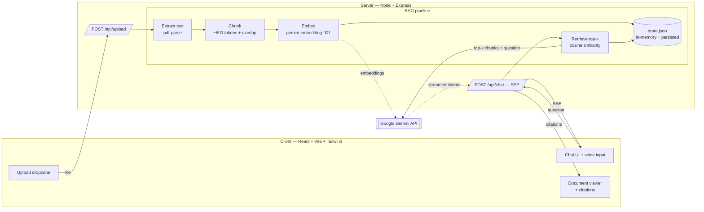
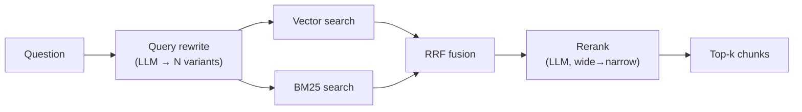

# DocSaathi 📄🤝

**Chat with your documents in English, Hindi, or Hinglish.**

DocSaathi is a full-stack, multilingual AI document-chat app built on **Retrieval-Augmented Generation (RAG)**. Upload a PDF or text file, ask questions in the language you're comfortable in, and get streamed answers grounded in your document — with **clickable citations** that jump to the exact source passage. It also supports **Hindi voice input** via the browser's Web Speech API.

> _Saathi_ (साथी) means "companion" in Hindi — DocSaathi is a companion for reading and understanding your documents.

---

## ✨ Features


---

## 🏗️ Architecture



---

## 🧩 How RAG works in this project

_(This section is written so you can explain it in an interview.)_

Large language models don't know the contents of **your** document. RAG bridges that gap by **retrieving** relevant passages first, then asking the model to answer using only those passages. Four stages:

1. **Ingest & chunk** — When you upload a file, we extract its text and split it into overlapping ~600-token **chunks**. Overlap ensures a sentence split across a boundary isn't lost. Each chunk keeps metadata: source file, page number, chunk index.

2. **Embed & store** — Each chunk is sent to Gemini's `gemini-embedding-001` model, which returns a **vector** (a list of numbers capturing meaning). We store `{ chunk text + metadata + vector }` in an in-memory array that's persisted to `server/data/store.json` so it survives restarts. _(For an MVP this beats a hosted vector DB — same core idea, zero infra, fully explainable.)_

3. **Retrieve** — When you ask a question, we embed the **question** the same way, then compute **cosine similarity** between the question vector and every chunk vector. The top-k most similar chunks are the ones most likely to contain the answer.

4. **Augment & generate** — We build a prompt containing the retrieved chunks (numbered `[1] [2] …`) plus your question, and ask Gemini to answer **using only those sources** and to cite them by number. The answer is **streamed** back token-by-token over SSE, and the numbered citations become clickable links to the source passages.

**Why cosine similarity?** Embedding vectors encode meaning as direction, not magnitude. Cosine similarity measures the angle between two vectors, so it captures "these mean similar things" regardless of length — the standard choice for semantic search.

---

## 🧠 Retrieval architecture (advanced RAG)

Naive RAG does a single vector search and calls it a day. DocSaathi instead runs a **composable, multi-stage retrieval pipeline** ([`server/src/rag/retrieval/pipeline.ts`](server/src/rag/retrieval/pipeline.ts)) where every stage is a toggle. Better retrieval is the single biggest lever on RAG answer quality — and making the stages toggleable is what powers the evaluation harness below.



| Stage | File | What & why |
|---|---|---|
| **Query rewriting** | [`queryRewrite.ts`](server/src/rag/retrieval/queryRewrite.ts) | One LLM call expands the question into 2–3 search-optimized variants (and English variants for Hindi/Hinglish questions). Each is retrieved separately and fused — widens recall. |
| **Hybrid search** | [`bm25.ts`](server/src/rag/retrieval/bm25.ts), [`rrf.ts`](server/src/rag/retrieval/rrf.ts) | Vector search (meaning) **+** a hand-written BM25 keyword index (exact terms, names, IDs), combined with **Reciprocal Rank Fusion**. Covers what either method alone misses. |
| **Reranking** | [`rerank.ts`](server/src/rag/retrieval/rerank.ts) | Retrieve a **wide** candidate pool (~20), then let the LLM score each for true relevance and keep the best few. Usually the biggest precision win. |
| **Contextual retrieval** | [`contextual.ts`](server/src/rag/contextual.ts) | *(Optional, ingest-time)* Prepend an LLM-written context blurb to each chunk before embedding, so out-of-context chunks stay findable (Anthropic's technique). |

Every stage is controlled by an env flag (`RAG_HYBRID`, `RAG_QUERY_REWRITE`, `RAG_RERANK`, `RAG_CONTEXTUAL`). **Defaults are quota-lean:** hybrid on (it's free/local), rewrite + rerank off (each costs a generation call — see the free-tier note in Setup). The chat stream also emits a `trace` event showing which stages ran.

---

## 📊 Evaluation (measuring retrieval quality)

> _You can't improve what you don't measure._ This is the part most portfolio RAG projects skip.

`npm run eval` runs an **ablation study**: it ingests a known document, runs a golden Q&A set through several retrieval configs, and prints a scorecard so you can see what each technique actually buys you.

**Metrics** ([`server/src/eval/metrics.ts`](server/src/eval/metrics.ts)):

| Metric | Type | Measures |
|---|---|---|
| **Context Recall** | Objective (substring) | Did retrieval surface the passages known to contain the answer? |
| **Context Precision** | Objective (substring) | Of the retrieved chunks, how many were actually relevant? |
| **Faithfulness** | LLM-as-judge | Is the generated answer grounded in the retrieved context (no hallucination)? |
| **Answer Relevance** | LLM-as-judge | Does the answer actually address the question? |

The golden set ([`dataset.json`](server/src/eval/dataset.json)) uses exact `relevantText` substrings so the retrieval metrics are **objective** (no LLM needed), and runs against an isolated store so evaluation never touches your real data.

```bash
npm run eval                                   # full ablation (uses generation quota)
EVAL_JUDGE=false EVAL_CONFIGS=2 npm run eval    # retrieval-only metrics (embeddings only)
EVAL_QUESTIONS=3 EVAL_TOPK=1 npm run eval       # smaller/tighter run
```

Sample scorecard:

```
  Config                  Context Recall   Context Prec.   Faithfulness   Answer Rel.
  baseline (vector-only)           100.0            33.3           ...           ...
  hybrid (vector+BM25)             100.0            33.3           ...           ...
  hybrid + rerank                    ...             ...           ...           ...
  hybrid + rewrite + rerank          ...             ...           ...           ...
```

**An honest finding:** on this small, clean benchmark, `gemini-embedding-001` already achieves perfect top-k recall, so hybrid/rerank don't move the numbers here — the value of those techniques shows on **larger, noisier, or vocabulary-mismatched** corpora. That's the point of having a harness: it tells you *when* a technique helps instead of assuming it always does. _(Note: the free Gemini tier caps generation at ~20 requests/day, so the LLM-judged columns and rerank/rewrite configs need the daily reset or a billed key to run in full; the embeddings-only retrieval metrics run freely.)_

---

## 📁 Project structure

```
DocSaathi/
├── server/            # Express + TypeScript API (RAG pipeline, SSE)
│   └── src/
│       ├── config.ts        # env loading + validation + retrieval flags
│       ├── index.ts         # express app + routes + error handler
│       ├── routes/          # upload.ts, chat.ts, documents.ts
│       ├── rag/             # chunk, embed, store, retrieve, contextual
│       │   └── retrieval/   # pipeline, bm25, rrf, queryRewrite, rerank (Track A)
│       ├── eval/            # ablation harness: dataset, metrics, scorecard (Track B)
│       ├── llm/gemini.ts    # Gemini client, streaming, retry/backoff, JSON
│       └── lib/pdf.ts       # PDF/txt text extraction
├── client/            # React + Vite + Tailwind frontend
│   └── src/
│       ├── components/      # chat UI, upload, citations, document viewer
│       ├── hooks/           # useChatStream (SSE), useVoiceInput (Web Speech)
│       └── lib/api.ts       # API client
├── .env.example       # copy to .env and add your key
└── package.json       # root — runs client + server together
```

---

## 🚀 Setup & running locally

### 1. Get a free Gemini API key

Go to **[Google AI Studio → API keys](https://aistudio.google.com/app/apikey)**, sign in with a Google account, click **Create API key**, and copy it. The free tier is enough for this app.

> **Note on models & quota:** DocSaathi defaults to `gemini-flash-latest` (chat) and `gemini-embedding-001` (embeddings) — both configurable in `.env`. Free-tier quota is **per-model** and varies by project/region, so a specific model (e.g. `gemini-2.0-flash`) may report a `429` with `limit: 0` even though your key is valid. If that happens, list the models your key can use with:
> ```bash
> curl "https://generativelanguage.googleapis.com/v1beta/models?key=YOUR_KEY"
> ```
> and set `GEMINI_CHAT_MODEL` in `.env` to one whose `supportedGenerationMethods` includes `generateContent`.

### 2. Configure your environment

From the project root:

```bash
cp .env.example .env
```

Open `.env` and paste your key:

```
GEMINI_API_KEY=your_key_here
```

### 3. Install dependencies

```bash
npm install      # run from the project root — installs client + server together
```

### 4. Run it

```bash
npm run dev      # starts the Express API (:3001) and the Vite client (:5173)
```

Open **http://localhost:5173**, upload a document, and start chatting.

---

## ☁️ Deploying (Render, one service)

In production, Express serves the built React client from `client/dist`, so the
whole app runs as **one** Node web service — no separate frontend host, no CORS
config, and SSE streaming works because it's a long-running process (not
serverless). A [`render.yaml`](render.yaml) Blueprint is included.

1. Push the repo to GitHub.
2. In [Render](https://dashboard.render.com): **New → Blueprint → select this repo**.
   Render reads `render.yaml` and creates the `docsaathi` web service.
3. When prompted, paste your `GEMINI_API_KEY`. Everything else has defaults.
4. Wait for the build (`npm ci && npm run build`) and open the service URL.

To run the production build locally:

```bash
npm run build && npm start     # serves UI + API together on http://localhost:3001
```

**Persistence note:** the vector store is a JSON file on disk. On Render's free
plan the filesystem is ephemeral, so uploaded documents disappear on restart or
redeploy (just re-upload — fine for a demo). For durable storage, upgrade the
service and uncomment the `disk` + `STORE_PATH` lines in `render.yaml`.

Any host that runs a plain Node process works the same way (Railway, Fly.io, a
VPS). Vercel/Netlify functions are **not** a good fit: they drop the on-disk
store between invocations and cut off long SSE streams.

---

## 🛠️ Tech stack & why

| Layer | Choice | Why |
|---|---|---|
| Frontend | React + TypeScript + Vite | Fast dev server, typed components, industry standard |
| Styling | Tailwind CSS | Rapid, consistent UI without leaving markup |
| Backend | Node + Express + TypeScript | Minimal, well-understood, easy to explain |
| LLM & embeddings | Google Gemini (`@google/generative-ai`) | Free tier, strong multilingual (great for Hindi/Hinglish) |
| Vector storage | In-memory cosine search, persisted to JSON | MVP-appropriate; no infra; demonstrates the concept from scratch |
| Streaming | Server-Sent Events (SSE) | One-way server→client streaming — simpler than WebSockets, perfect for token streaming |
| Virtualization | react-window | Keeps long chat histories smooth by rendering only visible rows |
| Voice | Web Speech API | Native browser speech recognition; zero dependencies |

---

## 📝 License

MIT — this is a personal portfolio project. Feel free to learn from it.
